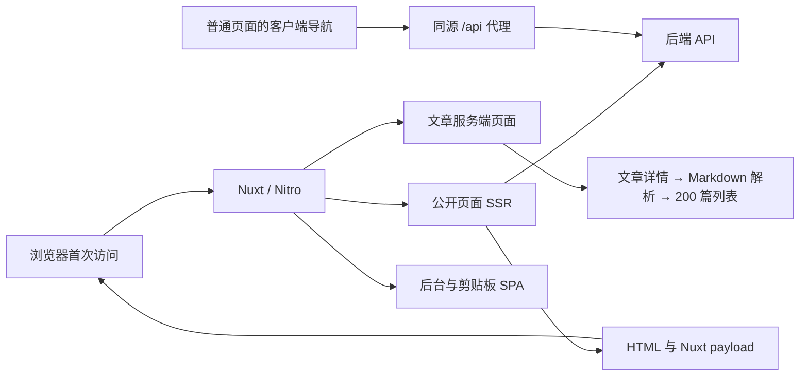

# SSR 与性能架构评估

评估日期：2026-10-13。范围：当前前端源码、现有生产产物、运行中的本地开发服务，以及独立端口上的受控生产验证。未修改应用代码、未执行线上压力测试。

## 判断

Nuxt 的混合渲染方向适合这个项目：公开博客需要可索引的 HTML，后台和剪贴板适合客户端渲染。首页、博客列表与时间轴已经并行获取独立数据，文章正文采用服务端页面，可减少正文的客户端执行开销。

当前更需要补齐的是数据请求的可靠性、公开内容缓存、文章渲染契约，以及客户端资源和导航开销。仅仅启用 SSR，不会自动获得跨请求缓存、低 TTFB 或轻量客户端。

## 验证口径

- 3000 端口运行的是 `nuxt dev`，不能作为生产性能基线。
- 本地首页返回 200，但 HTML 没有文章链接，Nuxt payload 的 `posts` 与 `tagsCount` 包含 500 错误；`/api/v1/posts?page=1&limit=12` 返回 502。
- 从本机直连配置中的后端域名出现 TLS 连接错误。这里只能确认本机访问失败，不能推断线上所有用户都无法访问。
- 独立启动已有 `.output`，使用 3101 端口；3102 端口是无人工延迟的本地只读模拟 API。数据为 200 篇合成文章，每篇含一个 30 行代码块。
- 模拟响应采用前端页面所要求的契约：文章列表的外层 `data` 是 `{ data: posts, pagination }`；标签统计的外层 `data` 是数组。
- 每个页面连续请求 3 次，记录响应头到达耗时、HTML/payload 体积以及 HTML 声明的 JS/CSS。这个小样本不是 p95、QPS 或完整浏览器性能测试。
- 生产产物沿用项目已有构建，没有重新构建。因此产物问题还应在下一次干净构建中复核。
- Gzip 数值是本地压缩估算；未测量线上 Brotli、CDN、网关或真实移动设备。JS 数字是入口和 modulepreload 声明资源之和，不包括所有动态请求，也不代表 JS 执行耗时。

## 当前架构

| 路由 | 当前方式 | 适用性 |
| --- | --- | --- |
| `/`、`/blog/**`、`/tag/**`、`/archives`、`/timeline`、`/about`、`/navigationBar` | 默认 SSR，普通 Vue 页面在浏览器 hydration | 方向合理，但公开内容缺少缓存策略 |
| `/article/**` | `.server.vue`，构建中注册为 `page_article-slug` island | 适合静态正文，但必须明确交互组件边界 |
| `/admin`、`/admin/**` | `ssr: false` | 合理 |
| `/clipboard` | `ssr: false` | 合理 |
| `/api/v1/**` | Nitro 代理固定后端地址 | 需要与 SSR 的运行时 API 地址保持一致 |

文章服务端页面并不代表整个网站没有客户端 JS：导航、主题、登录弹窗与全局 UI 仍然需要客户端资源。

## 受控结果

单位为 KiB；TTFB 单位为毫秒。第一次指该路径在本次进程中的首次请求，不是每个页面各自独立的冷进程。

| 页面 | TTFB：首次 / 后两次 | HTML | payload | 首屏声明 JS：原始 / gzip 估算 |
| --- | --- | ---: | ---: | ---: |
| 首页 | 914.5 / 23.3 / 16.1 | 60.4 | 4.7 | 671.6 / 223.5 |
| 博客第 1 页 | 148.1 / 25.4 / 21.1 | 63.3 | 4.0 | 740.5 / 243.0 |
| 标签页，100 条 | 105.7 / 29.5 / 31.4 | 203.1 | 28.6 | 821.2 / 271.5 |
| 归档页，200 条 | 19.2 / 13.6 / 13.8 | 145.8 | 56.6 | 662.3 / 219.5 |
| 时光轴，100 条 | 369.2 / 30.3 / 23.8 | 212.6 | 28.7 | 1295.3 / 431.4 |
| 文章详情 | 293.5 / 25.8 / 19.6 | 57.5 | 16.0 | 659.2 / 217.7 |

所有正常公开 HTML 响应在本地均没有 `Cache-Control` 或 `Content-Encoding`。测试请求没有协商压缩；该结果不能证明线上网关未压缩。

重复请求仍然会访问模拟后端；文章详情的 3 次请求分别都执行详情查询与 `limit=200` 列表查询。后两次更快主要说明进程、模块与解析器已经预热，不能据此认定有内容缓存。

## 优先处理的问题

### P1：SSR 数据失败没有形成一致的响应语义

证据：当前开发首页文章数据失败后仍然返回空内容的 200；受控 API 对不存在文章返回 404，而前端文章页返回 500。生产日志出现 `Cannot read properties of undefined (reading 'name')`。

原因：文章页在请求失败后使用 `data.value || {}`，模板仍访问 `article.category.name`。多个页面只在 `useAsyncData` 外套 `try/catch`，没有读取返回的 `error`；首页又把失败回退值当作正常响应访问 `.data`。

建议：在渲染前检查 `error` 和数据契约，明确区分 404、后端故障和真正的空列表。HTTP 封装应保留 FetchError 的状态和原因；目前在错误 hook 中直接抛出上下文对象，会让上层错误信息难以使用。为后端请求设定显式超时并透传取消信号；对重试设上限。

位置：[文章页](/Users/zhuzhongqian/orca/projects/nuxt_web/app/pages/article/[slug].server.vue:91)、[首页](/Users/zhuzhongqian/orca/projects/nuxt_web/app/pages/index.vue:154)、[HTTP 封装](/Users/zhuzhongqian/orca/projects/nuxt_web/app/composables/http.ts:33)。

### P1：文章页在关键渲染路径中执行不必要的串行工作

链路是：文章详情 → `parseMarkdown` → 拉取最多 200 篇文章 → 遍历寻找上下篇 → 返回 HTML。上下篇失败虽然不会主动抛错，但这个请求仍然被等待，会拖延正文响应。超过这 200 篇范围的文章也不能正确获得相邻项。

建议：先核实项目文档已有的 `/v1/posts/:uuid/prevnext` 接口，再用该接口或详情接口中的轻量相邻文章字段替代列表查询。没有合并接口时，并行请求详情与相邻项。将 Markdown 解析结果按文章 UUID 与内容版本/内容哈希缓存，或在发布时预处理；不要用只有 UUID 的永久缓存。

在这次服务端页面验证中，200 篇原始列表没有直接进入浏览器 payload。因此这里主要是后端查询、网络与服务端渲染成本，不能把列表体积直接当成文章页下载体积。

位置：[解析正文](/Users/zhuzhongqian/orca/projects/nuxt_web/app/pages/article/[slug].server.vue:97)、[上下篇查询](/Users/zhuzhongqian/orca/projects/nuxt_web/app/pages/article/[slug].server.vue:211)。

### P1：生产文章的代码块组件未正确解析

受控生产 HTML 出现 `<ProsePre ...>` 原始标签，浏览器 DOM 没有文章代码块的 `<pre>`，没有自定义复制与展开按钮。站内相邻文章链接可以正常到达下一篇，但这不代表正文中的 Vue 事件已经 hydration。

当前源码已经定义了 `ProsePre`；现有构建中的渲染结果表明组件解析/映射链路需要复核。先用干净生产构建定位组件注册和 ContentRenderer/MDC 映射，再决定交互实现。即使组件成功在服务端渲染，整个 `.server.vue` 正文里的普通 Vue 事件也不能自动获得客户端执行。

架构上可保留服务端静态正文，把复制、展开、目录跟随放到明确的客户端组件边界；如果希望全部正文组件按普通 Vue 工作，也可使用普通 `.vue` SSR 页面，并让解析工作留在服务端接口中。应根据需要的交互与 payload 代价选择，而不是仅依据文件后缀。

位置：[正文渲染](/Users/zhuzhongqian/orca/projects/nuxt_web/app/pages/article/[slug].server.vue:34)、[代码块组件](/Users/zhuzhongqian/orca/projects/nuxt_web/app/components/ProsePre.vue:1)。

### P1：公开内容缺少跨请求缓存

`routeRules` 目前配置了 SSR 开关和代理，但没有公开页面 SWR；服务端代码也没有文章、列表或 Markdown 的缓存实现。`useAsyncData` 的 payload 复用解决 hydration 数据传递，不能代替多次 HTTP 请求之间的内容缓存。

建议先针对公开 GET 数据建立缓存与失效规则，再启用页面缓存；避免把数据失败后生成的空 200 页面缓存下来。单实例先使用 Nitro 的缓存能力即可，多实例且需要一致失效时再考虑共享存储。

| 内容 | 建议初始策略，需结合更新频率验证 |
| --- | --- |
| 首页、分页列表、标签列表 | 30–60 秒 SWR |
| 文章正文与轻量元数据 | 5–10 分钟缓存，发布/编辑时失效 |
| Markdown 解析结果 | 按内容版本缓存 |
| 标签统计、分类、归档摘要 | 1–5 分钟缓存，发布时同步失效 |
| 导航静态数据 | 预渲染或较长缓存 |
| 关于页 | 先剥离最新文章动态块，再考虑预渲染 |
| 后台、登录、剪贴板、用户数据 | 保持请求级数据，不套用公开内容缓存 |

文章页还存在 island 请求路径，不能只验证直接访问 `/article/**`。必须同时验证从其他页面进入文章时，island 渲染路径是否复用缓存；优先把缓存放在文章数据与解析层。发布文章后的失效范围包括文章本身、首页、列表、相关标签、归档与 sitemap。

位置：[路由规则](/Users/zhuzhongqian/orca/projects/nuxt_web/nuxt.config.ts:47)。缓存机制可参考 [Nuxt 官方服务端与路由规则文档](https://github.com/nuxt/nuxt/blob/main/docs/1.getting-started/13.server.md)。

### P1：同一个 async-data key 对应不同接口

博客列表的 `useAsyncData("tags")` 请求 `/v1/tags`，标签页同一个 key 请求 `/v1/tags/count`，两处期待的数据结构也不同。这是数据复用和维护上的冲突；是否在特定导航顺序触发运行错误，受当前 Nuxt 清理与复用行为影响，不能仅凭 key 判定每次必现。

建议统一定义 composable，使用清晰且一致的 key，例如 `tags:list` 和 `tags:counts`，并确保相同 key 使用一致 handler 和转换方式。[Nuxt 官方说明](https://github.com/nuxt/nuxt/blob/main/docs/4.api/2.composables/use-async-data.md)明确规定同 key 共享状态、相关选项应保持一致。

位置：[博客列表](/Users/zhuzhongqian/orca/projects/nuxt_web/app/pages/blog/[slug].vue:35)、[标签页](/Users/zhuzhongqian/orca/projects/nuxt_web/app/pages/tag/[slug].vue:18)。

## 客户端与体积问题

### P2：全局资源体积掩盖了文章服务端渲染的收益

首页声明约 672 KiB JS，文章页仍约 659 KiB；时光轴约 1.3 MiB。共享 CSS 约 236.8 KiB，gzip 估算约 31.2 KiB。单独分包不会减少下载量；当前手动分出的 VueUse chunk 原始约 147.3 KiB，并在首页被声明预加载。

建议按实际入口依赖做 bundle 分析，关注全局布局、登录弹窗和 UI 的共享依赖；在打开弹窗前延迟加载非首屏交互组件。时光轴使用 ECharts core 和按需注册，这个方向已经正确，但图表仍静态引入；可用异步客户端组件，在接近可视区且设备需要图表时加载。仅使用 `hidden lg:block` 不会阻止下载和挂载。

源码没有直接使用 `NuxtImg`。安装图片模块不能自动优化普通 `` 的尺寸或格式。头像、导航图标和文章封面应按显示尺寸输出，补齐尺寸约束和合适的懒加载；首屏关键图片应单独确定优先级。静态文件 `blog.png` 约 2.9 MiB，但本次未证明首屏使用它，不能把它直接计为首屏成本；`blog.webp` 约 16 KiB。

位置：[VueUse 分包](/Users/zhuzhongqian/orca/projects/nuxt_web/nuxt.config.ts:74)、[热图](/Users/zhuzhongqian/orca/projects/nuxt_web/app/components/timeline/CalendarHeatmap.vue:110)。

### P2：列表传输字段和规模缺少边界

归档拉 200 篇，标签页和时光轴拉 100 篇。受控归档 payload 约 56.6 KiB，其中包含页面不使用的 Markdown 正文。这会扩大网络、序列化和客户端内存开销。分页上限也意味着归档总数不是完整总数，后台仪表盘把前 200 篇浏览量相加不等于全站浏览量。

建议后端提供 list/summary DTO，省略 `content`，按页面需求只返回展示字段；前端可先用 `transform` 裁剪返回对象，注意这种裁剪不能减少后端到 Nuxt 的传输量。归档和时间轴使用摘要接口、分段加载与真实总数，统计由后端聚合返回。对大数据列表再评估虚拟化，无需为当前小规模先引入复杂组件。

位置：[归档](/Users/zhuzhongqian/orca/projects/nuxt_web/app/pages/archives.vue:73)、[时间轴](/Users/zhuzhongqian/orca/projects/nuxt_web/app/pages/timeline.vue:75)、[后台统计](/Users/zhuzhongqian/orca/projects/nuxt_web/app/pages/admin/dashboard.vue:86)。

### P2：导航在主动增加等待与重复工作

`NuxtLayout :key="route.path"` 会在路径变化时重建布局，导航、页脚计时器、滚动监听和登录 UI 随之重新挂载。分页明确使用 `navigateTo(..., { external: true })`，触发完整页面加载。页面切换使用 `out-in`，CSS 出入场各 1 秒，且动画包含 blur；在发生页面过渡的导航中，会显著拖延用户感知。

建议让布局稳定复用，只在确实需要时重置页面；普通分页走内部导航，同时把路由参数/key 改为响应式，保证取消强制刷新后数据仍跟随页码更新。过渡缩短为约 150–200 毫秒，以 opacity/transform 为主，并支持减少动画偏好。首页与时间轴又各自放了一个回到顶部按钮，布局已有同组件，可删除重复实例与监听。

位置：[布局 key](/Users/zhuzhongqian/orca/projects/nuxt_web/app/app.vue:9)、[分页](/Users/zhuzhongqian/orca/projects/nuxt_web/app/components/blog/BlogDetail.vue:63)、[页面动画](/Users/zhuzhongqian/orca/projects/nuxt_web/app/assets/css/main.css:56)。

## 运维与索引

- HTTP 封装在成功请求与响应上打印完整对象。本次少量受控验证产生超过千行日志，生产中应改成结构化摘要与慢请求/异常采样，减少格式化和日志 I/O。现有滚动进度组件已经使用 passive 和 rAF；导航页的每次滚动查询全部节点并读取布局，可改用 IntersectionObserver。它们的优先级低于缓存和主请求链路。
- SSR 使用可配置 `public.apiBase`，浏览器代理目标却写死；默认生产配置没有指定地址时，SSR 还可能经内部代理。将后端地址放入服务端运行时配置，并为 SSR 与代理使用同一来源，避免环境切换时两端指向不同后端。
- sitemap 把列表响应的外层 `data` 当数组，和页面使用的嵌套列表结构不一致。在受控数据契约下只得到基础路由与标签，未生成任何文章 URL。需对真实后端契约复核后修正，并处理超过 500 篇时的完整分页；这不是生产索引量的实测结论。
- 页面标题已包含站点名，`app.vue` 又追加一次；实际生产标题重复。首页的 `og-image.png` 和 `apple-touch-icon.png` 不在当前 public 目录，应核实资源响应并补齐。
- Dockerfile 构建用 `node:24-alpine`，运行写作 `node:22_alpine`。运行镜像标签需核验并修正；构建/运行 Node 主版本也应一致，项目带有原生依赖。Docker 使用 `npm i`，没有消费现有 pnpm/Bun 锁文件，应统一包管理器并采用锁定安装。
- 部署脚本先停止并删除旧容器，再加载新镜像，存在明确服务中断窗口。优先改为新实例先健康、再切流。健康检查仅检查 `/` 的状态码，会将这次空内容 200 判为正常，应分别检查进程存活和带数据的就绪状态。

位置：[sitemap](/Users/zhuzhongqian/orca/projects/nuxt_web/server/api/__sitemap__/urls.ts:24)、[Dockerfile](/Users/zhuzhongqian/orca/projects/nuxt_web/Dockerfile:20)、[部署切换](/Users/zhuzhongqian/orca/projects/nuxt_web/deploy.sh:568)。

## 建议实施顺序与验收

1. 修复数据契约、404/故障处理和请求超时，恢复真实后端可用的 SSR 数据；修复代码块组件解析，使用干净生产构建验证。
2. 删除文章页 200 篇列表查询，缓存公开数据和 Markdown 解析；定义发布/编辑失效流程，再增加公开页面 SWR。
3. 保持布局稳定、改为正常分页导航、缩短过渡；确保响应式参数变化能正确更新页面数据。
4. 裁剪列表字段，延迟图表和全局非首屏组件，分析共享 JS/CSS。确认网关压缩与哈希静态资源的长期缓存。
5. 修复 sitemap 与部署可复现性，加入可观测指标，建立真实生产基线。

后续验收应包括：刷新与站内进入文章都能看到正确正文；404 返回正确状态；API 故障不生成可缓存的空成功页；正文代码复制/展开和目录交互正常；重复访问减少后端与解析调用；发布后相关页面及时更新；文章超过 200 篇仍可正确归档和导航。

性能测量应记录 TTFB 分位数、后端耗时、Markdown 解析耗时、渲染/序列化耗时、缓存命中率、响应大小、事件循环延迟和容器 CPU/内存，并在真实移动设备或明确的网络/CPU限速条件下测量首屏与交互。可使用 `Server-Timing` 区分 API、解析、渲染时间。

客户端体验以真实用户 p75 的 LCP ≤ 2.5 秒、INP ≤ 200 毫秒、CLS ≤ 0.1 为验收目标，分别统计移动与桌面；这些是 [Google Web Vitals 指标目标](https://web.dev/articles/vitals)，本次没有测得这些指标，也没有依据推算当前可支持的并发量。
